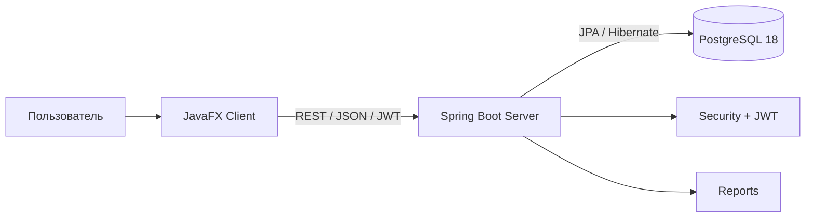
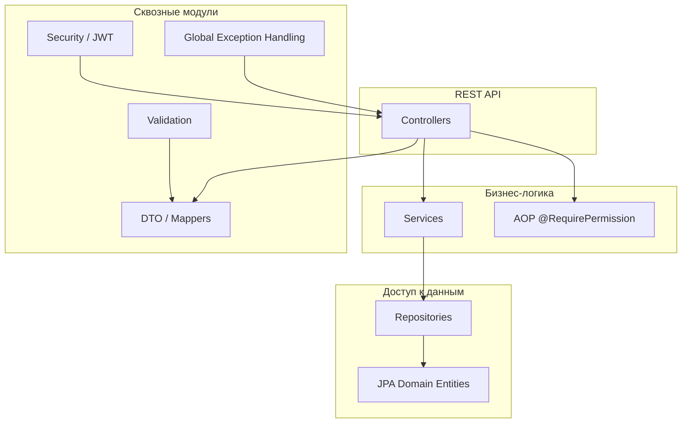
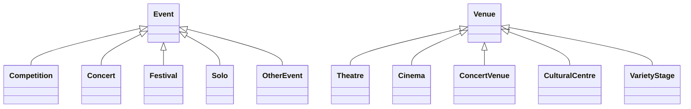
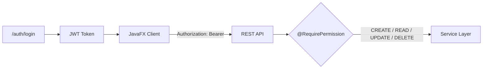
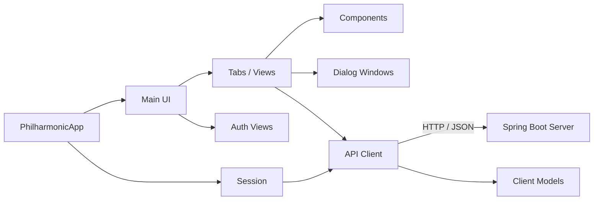
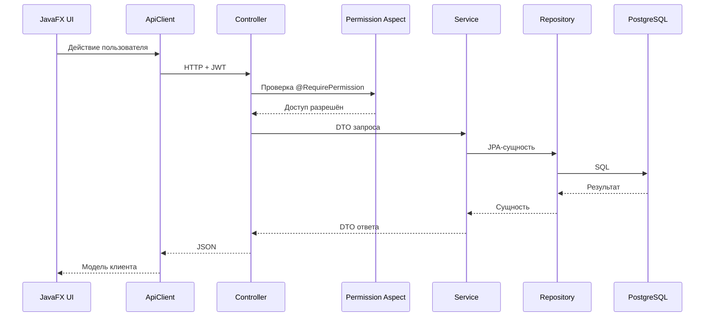

# Philharmonic Project

Учебный проект по курсу БД. Система управления филармонией с кастомной системой ролей – бэкенд на Spring Boot, и клиентское приложение на JavaFX.

*Данные диаграммы полностью и анализ архитектуры по большей части сгенерированы ИИ для скорости, т.к. имеют лишь демонстративный характер.* 

## Структура проекта

- `Philharmonic-server/` – серверная часть (Spring Boot + Hibernate JPA + Security)
- `Philharmonic-client/` – клиентская часть (JavaFX)

Проект демонстрирует:
- доменную модель с наследованием для мероприятий и площадок;
- REST API с DTO, валидацией и единым форматом ошибок;
- ролевую модель доступа на основе permissions и JWT;
- клиент-серверное взаимодействие через JSON;
- MVC-подход в JavaFX-клиенте с FXML и CSS.

---

## Технологический стек

| Компонент | Технологии |
|---|---|
| Сервер | Java 25, Spring Boot 4.0.6, Spring WebMVC, Spring Data JPA, Spring Security, Validation, AOP |
| БД | PostgreSQL 18, Hibernate/JPA |
| Аутентификация | JWT (jjwt 0.12.6), permissions |
| Клиент | Java 25, JavaFX 25, FXML, CSS, AtlantaFX, Jackson |
| Сборка | Maven |
| Инфраструктура | Docker, Docker Compose (dev/prod) |

---

## Высокоуровневая архитектура



Клиент не работает с БД напрямую. Все операции проходят через REST API сервера. Сервер инкапсулирует бизнес-логику, доступ к данным, безопасность и валидацию.

---

## Серверная архитектура

Сервер организован по **feature-based** принципу: каждый доменный модуль содержит собственные `controller`, `service`, `repository`, `domain`, `dto`.



### Основные модули сервера

| Модуль | Назначение |
|---|---|
| `artist` | Артисты, жанры, импресарио |
| `events` | Мероприятия и их типы: `competition`, `concert`, `festival`, `solo`, `otherevent`, базовый `event` |
| `venues` | Площадки и их типы: `theatre`, `cinema`, `concert`, `culturalcentre`, `varietystage`, базовый `venue` |
| `genre` | Музыкальные жанры |
| `impresario` | Импресарио |
| `organizer` | Организаторы мероприятий |
| `identity` | Пользователи, роли, аутентификация: `auth`, `role`, `user` |
| `reports` | Отчёты и агрегированные данные |
| `shared` | Общие компоненты: аннотации, аспекты, конфигурация, безопасность, исключения, утилиты |

### Наследование доменной модели

Ключевая архитектурная особенность — наследование JPA-сущностей для событий и площадок.



Такой подход позволяет:
- хранить общие поля в базовых сущностях;
- добавлять специфичные атрибуты в подтипах;
- использовать полиморфные запросы и DTO;
- расширять модель без дублирования кода.

---

## Безопасность

Безопасность построена на **JWT**, кастомных ролях и разрешениях.



Роли по умолчанию:

| Роль | Разрешения |
|---|---|
| `USER` | `READ` |
| `ADMIN` | `CREATE`, `READ`, `UPDATE` |
| `SUPERADMIN` | `CREATE`, `READ`, `UPDATE`, `DELETE` |

Все эндпоинты, кроме `/auth/**`, требуют JWT. Для проверки прав используются аннотации вида `@RequirePermission("CREATE")` и AOP-аспекты.

---

## Клиентская архитектура

Клиент — JavaFX-приложение, разделённое на API-слой, модели, сессию и UI-компоненты.



### Структура клиента

| Пакет | Назначение |
|---|---|
| `api` | HTTP-клиент для взаимодействия с REST API |
| `model` | Модели данных клиента |
| `session` | Текущая сессия, токен, пользователь |
| `ui.auth` | Окна и логика аутентификации |
| `ui.main` | Главное окно приложения |
| `ui.tabs` | Вкладки для работы с сущностями |
| `ui.components` | Переиспользуемые UI-компоненты |
| `ui.dialog` | Диалоговые окна |
| `ui.util` | Вспомогательные UI-утилиты |
| `util` | Общие утилиты |

Ресурсы клиента:
- `css/` — стили, включая тему AtlantaFX;
- `fxml/` — FXML-разметка;
- `fxml/tabs/` — FXML для вкладок.

---

## Поток выполнения запроса



---

## Обзор API

API сгруппирован по доменным областям.

| Группа | Примеры эндпоинтов |
|---|---|
| Аутентификация | `/auth/login`, `/auth/register` |
| Артисты | `/api/artists` |
| Площадки | `/api/venues`, `/api/venues/theatres`, `/api/venues/cinemas` |
| Мероприятия | `/api/events`, `/api/events/competitions`, `/api/events/concerts`, `/api/events/solo` |
| Результаты конкурсов | `/api/competition-results` |
| Импресарио | `/api/impresarios` |
| Организаторы | `/api/organizers` |
| Жанры | `/api/genres` |
| Пользователи и роли | `/api/users`, `/api/roles` — только для `SUPERADMIN` |

Ответы с ошибками унифицированы: `timestamp`, `status`, `error`, `message`, `path`, `details`. Поддерживаются ошибки валидации, 403, 404 и 500.

---

## Структура репозитория

```text
Philharmonic-server/
├── Dockerfile
├── docker-compose.yml
├── docker-compose.prod.yml
├── pom.xml
├── Query.sql
├── README.md
├── curl-examples.md
├── src/main/java/com/npopov/philharmonic/
│   ├── artist/
│   ├── events/
│   │   ├── competition/
│   │   ├── concert/
│   │   ├── event/
│   │   ├── festival/
│   │   ├── otherevent/
│   │   └── solo/
│   ├── genre/
│   ├── identity/
│   │   ├── auth/
│   │   ├── role/
│   │   └── user/
│   ├── impresario/
│   ├── organizer/
│   ├── reports/
│   ├── shared/
│   └── venues/
│       ├── cinema/
│       ├── concert/
│       ├── culturalcentre/
│       ├── theatre/
│       ├── varietystage/
│       └── venue/
└── src/main/resources/
    ├── static/
    └── templates/

Philharmonic-client/
├── pom.xml
├── src/main/java/com/npopov/philharmonic/client/
│   ├── api/
│   ├── model/
│   ├── session/
│   ├── ui/
│   │   ├── auth/
│   │   ├── components/
│   │   ├── dialog/
│   │   ├── main/
│   │   ├── tabs/
│   │   └── util/
│   └── util/
└── src/main/resources/
    ├── css/
    └── fxml/
        └── tabs/
```

---

## Особенности реализации

- **DTO-слой** отделяет API-контракты от JPA-сущностей.
- **Глобальная обработка исключений** возвращает предсказуемый JSON.
- **Валидация** входных данных выполняется через Spring Validation.
- **Наследование** используется для событий и площадок.
- **Permissions** с кастомной системой ролей, проверяются декларативно через аннотации и AOP.
- **Клиент** хранит JWT в сессии и добавляет его в заголовки запросов.
- **JavaFX UI** построен на FXML, CSS и компонентном подходе.
- **AtlantaFX** отвечает за современное оформление клиента.

---

## Документация

- `README.md` — общее описание серверной части и API.
- `curl-examples.md` — примеры запросов к REST API.
- `Требования к проекту.docx` — исходные требования к учебному проекту.

---

## Запуск клиента

Клиент написан на JavaFX и взаимодействует с сервером через REST API.

### 1. Сборка и запуск

```bash
cd philharmonic-client
./mvnw javafx:run
```

Приложение откроет окно входа. По умолчанию клиент подключается к `http://localhost:8080`. При необходимости адрес сервера можно переопределить параметром JVM:

```bash
./mvnw javafx:run -Dapi.baseUrl=http://your-server:8080
```

### 2. Сборка JAR

```bash
./mvnw clean package
```

Затем запустите:

```bash
java -jar target/philharmonic-client-1.0.0-SNAPSHOT.jar
```

## Начальные данные

При первом запуске сервер автоматически создаёт таблицы (черзе Hibernate, миграции не закладвыались в проект) и заполняет роли и разрешения.

Или можно использовать SQL скрипты из `src/main/resources` для создания схемы с триггерами и стартовых стандартных данных пользователей

Стандартные роли:

- `USER` – только чтение (permission: `READ`)
- `ADMIN` – создание и редактирование (`CREATE`, `READ`, `UPDATE`)
- `SUPERADMIN` – полный доступ (`CREATE`, `READ`, `UPDATE`, `DELETE`)

- Клиент использует **AtlantaFX** для оформления, все стили в `src/main/resources/css/app.css`.

Суперадминистратор может создавать пользователей и назначать роли через интерфейс клиента или напрямую через API.

Если такого нет, вы можете зарегистрироваться через endpoint `/auth/register` (доступен без авторизации) или вставить запись в БД вручную.

## API Contracts

Подробная документация API доступна в файле [`curl-examples.md`](./Philharmonic/curl-examples.md). Основные группы эндпоинтов:

- `/api/artists` – артисты
- `/api/venues` – площадки (с наследованием типов)
- `/api/events` – мероприятия (с наследованием типов)
- `/api/impresarios`, `/api/organizers`, `/api/genres`
- `/api/competitions`, `/api/competition-results`
- `/api/users`, `/api/roles` (только для SUPERADMIN)
- `/auth/login`, `/auth/register`

**Авторизация** основана на разрешениях (permissions). Методы контроллеров используют аннотацию `@RequirePermission("CREATE")` и т.д. Все эндпоинты (кроме `/auth/**`) требуют JWT токена в заголовке `Authorization: Bearer <token>`.

## Лицензия

Проект разработан исключительно в учебных целях.
